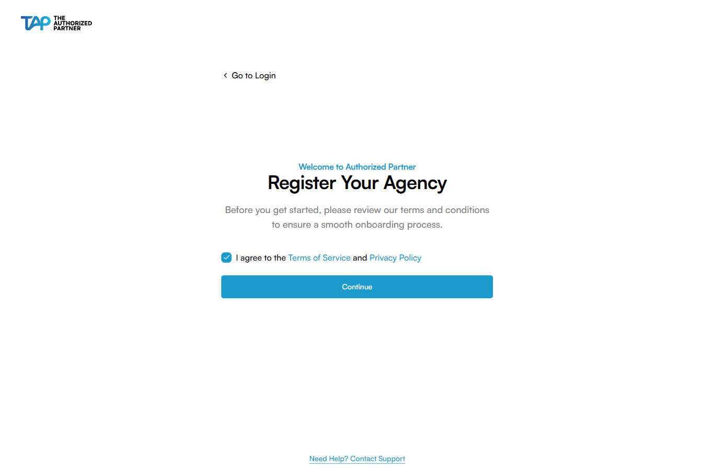
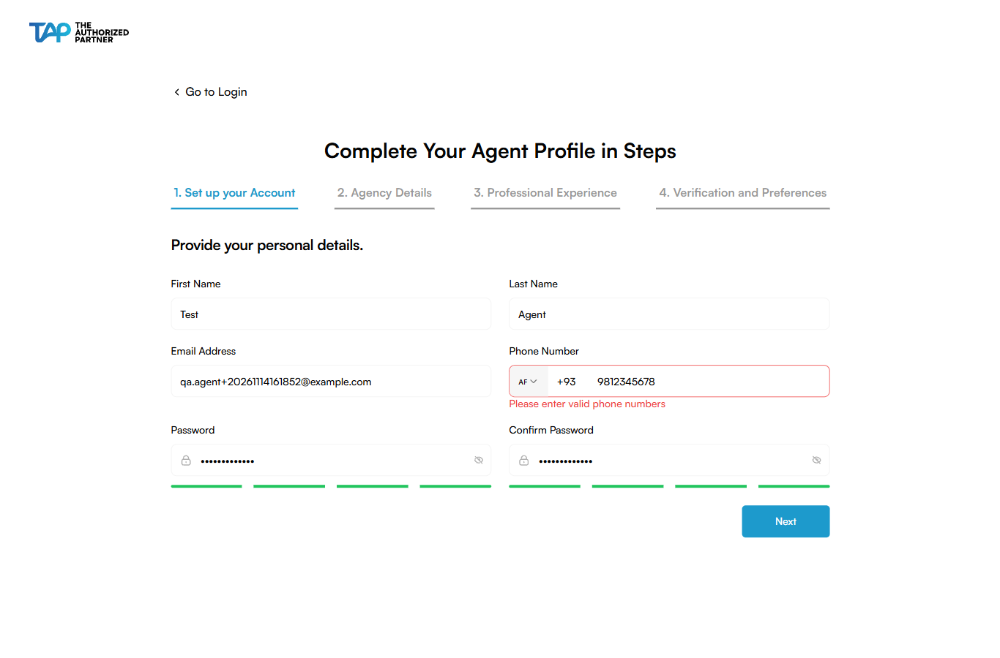
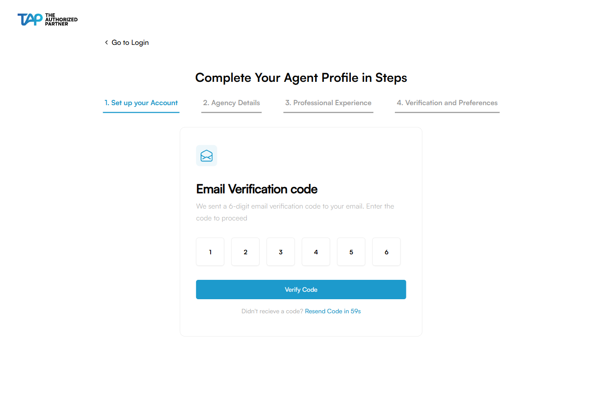
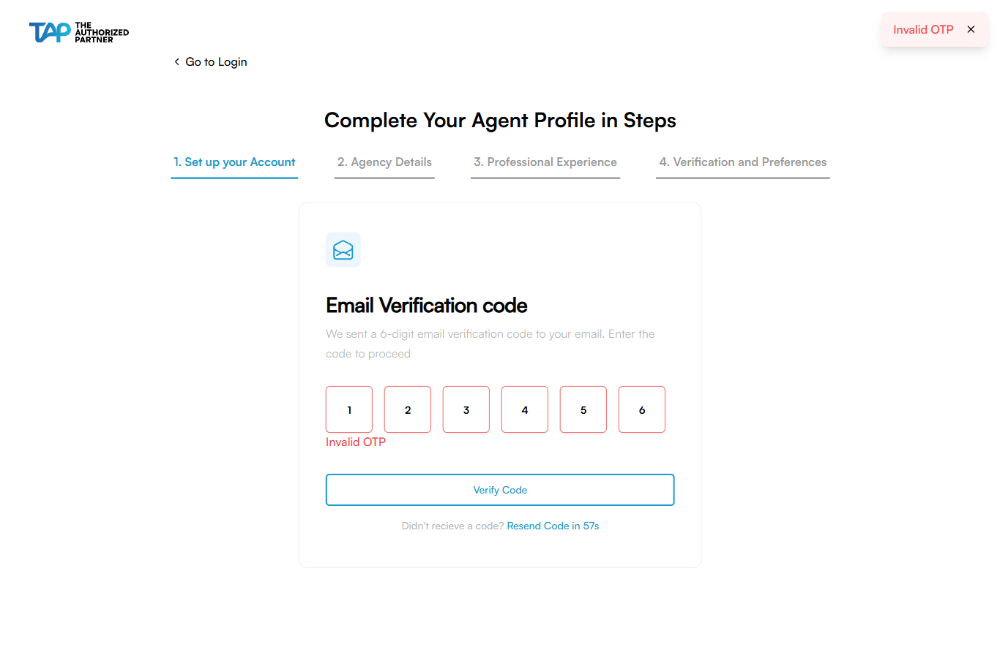

# Test Report - Authorized Partner signup automation

- **Result:** FAIL
- **Started:** 2026-11-14T16:18:52   **Duration:** 57.7s
- **Target:** https://authorized-partner.vercel.app/register
- **Evidence:** step 4: page did not advance after submit (validation: ['Invalid OTP', 'Notification Invalid OTP'])
- **Email used:** `qa.agent+20261114161852@example.com`

## Environment

| OS | Python | Playwright | Browser | Headless |
|---|---|---|---|---|
| Windows-11-10.0.26300-SP0 | 3.15.0rc1 | 1.65.2 | chromium | False |

## Steps

### Step 1 - Welcome to Authorized Partner
URL: `https://authorized-partner.vercel.app/register`  |  Clicked: **Continue**

| Field | Mapped to | Value |
|---|---|---|
| checkbox | tick | checked |

### Step 2 - Complete Your Agent Profile in Steps
URL: `https://authorized-partner.vercel.app/register?step=setup`  |  Clicked: **Next**

| Field | Mapped to | Value |
|---|---|---|
| First Name | first_name | Test |
| Last Name | last_name | Agent |
| Email Address | email | qa.agent+20261114161852@example.com |
| Phone Number | phone | 9812345678 |
| Phone Number | phone | 9812345678 |
| Password | password | ******** |
| Confirm Password | password | ******** |

### Step 3 - Complete Your Agent Profile in Steps
URL: `https://authorized-partner.vercel.app/register?step=setup`  |  Clicked: **Verify Code**

| Field | Mapped to | Value |
|---|---|---|
| input | otp | 123456 |

- page message: Invalid OTP
- page message: Notification Invalid OTP

### Step 4 - Complete Your Agent Profile in Steps
URL: `https://authorized-partner.vercel.app/register?step=setup`  |  Clicked: **Verify Code**

- page message: Invalid OTP
- page message: Notification Invalid OTP

## HTTP responses >= 400 seen during run

- `400 POST https://stage.cloudedu.com.au/api/tempuser/verify-otp/`
- `400 POST https://stage.cloudedu.com.au/api/tempuser/verify-otp/`

## Browser console errors

- Failed to load resource: the server responded with a status of 400 (Bad Request)
- Failed to load resource: the server responded with a status of 400 (Bad Request)
